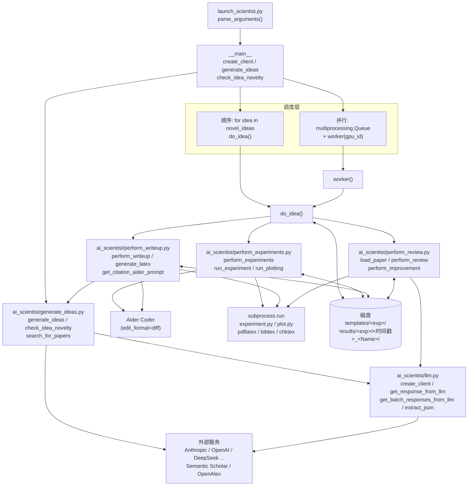

# The AI Scientist v1 — 系统架构

> 基于源码核验：`launch_scientist.py`、`ai_scientist/*.py`、`templates/*/`。
> 本文描述模块边界、进程/模型分工、核心数据结构与调用关系。

---

## 1. 架构总览

v1 是一个**单机编排器 + 外部服务调用 + 子进程执行**的流水线，没有常驻服务、没有数据库，状态全部以文件形式落在磁盘。可以分成 5 层：

1. **编排层**：`launch_scientist.py`（`__main__` + `do_idea` + `worker`）负责顺序/多 GPU 并行调度。
2. **认知层（LLM）**：`llm.py` 提供统一模型访问；`generate_ideas.py`、`perform_review.py`、`perform_writeup.py` 中的提示词与解析逻辑构成"大脑"。
3. **执行层（代码修改 + 运行）**：`aider` 的 `Coder` 负责改文件；`perform_experiments.py`/`perform_writeup.py` 用 `subprocess` 真实运行实验、绘图、LaTeX 编译。
4. **数据层（文件契约）**：模板目录 → 结果目录，靠固定文件名（`experiment.py`、`final_info.json`、`notes.txt`、`template.tex`、`*.png`）衔接。
5. **外部 API**：LLM 供应商（Anthropic/OpenAI/DeepSeek/Bedrock/Vertex/Gemini/OpenRouter）、文献检索（Semantic Scholar / OpenAlex）。

### 1.1 Mermaid 架构图



---

## 2. 关键模块职责与依赖方向

| 模块 | 依赖 | 被谁调用 | 职责 |
| --- | --- | --- | --- |
| `launch_scientist.py` | 全部 `ai_scientist.*`、`aider`、`torch` | 入口 | 参数解析、GPU 分配、并行调度、每个想法的全生命周期 |
| `ai_scientist/llm.py` | `anthropic`/`openai`/`google.generativeai`/`backoff` | 几乎所有认知模块 | 模型路由、消息格式适配、JSON 提取；**唯一**决定"用什么模型/API"的地方 |
| `ai_scientist/generate_ideas.py` | `llm.py`、`requests`、`backoff` | `launch_scientist.py`、`perform_writeup.py` | 想法生成与反思、文献搜索、新颖性判定 |
| `ai_scientist/perform_experiments.py` | `aider`、`subprocess` | `launch_scientist.do_idea` | 驱动 Aider 修改实验代码并迭代运行最多 `MAX_RUNS=5` 次 |
| `ai_scientist/perform_writeup.py` | `aider`、`generate_ideas.search_for_papers`、`subprocess` | `launch_scientist.do_idea` | 逐章节写 LaTeX、补引用、查错并编译 PDF |
| `ai_scientist/perform_review.py` | `llm.py`、`pypdf`/`pymupdf`/`pymupdf4llm` | `launch_scientist.do_idea` | PDF→文本、LLM 评审（集成 + 反思）、按评审改进 |

依赖要点：
- **无循环依赖**：`llm.py` 是最底层；`generate_ideas.py` 的 `search_for_papers` 被 `perform_writeup.py` 复用。
- **Aider 在两个地方各创建一次**：实验阶段 `do_idea` 用 `[experiment.py, plot.py, notes.txt]` 作 `fnames`；写作阶段用 `[experiment.py, latex/template.tex, notes.txt]`。二者都是 `InputOutput(yes=True, chat_history_file=...)` + `Coder.create(..., use_git=False, edit_format="diff", stream=False)`。
- **模型由命令行 `--model` 决定，评审固定用 GPT-4o**：见 `do_idea` 里 `perform_review(..., model="gpt-4o-2024-05-13", client=openai.OpenAI(), ...)`（写死，不随 `--model` 变化）。

---

## 3. 进程与并发模型

### 3.1 顺序模式（默认 `--parallel 0`）
`__main__` 直接串行遍历 `novel_ideas`，逐个调用 `do_idea()`；单个想法失败只打印 traceback，不中断后续。

### 3.2 并行模式（`--parallel N > 0`）
- 用 `multiprocessing.Queue` 存放所有 novel 想法；启动 N 个 `multiprocessing.Process(target=worker, args=(...))`。
- **GPU 绑定**：`get_available_gpus(args.gpus)` 返回 GPU id 列表（若 `--gpus` 未指定则用 `torch.cuda.device_count()`）；第 `i` 个 worker 使用 `available_gpus[i % len(available_gpus)]`，在 `worker()` 内通过 `os.environ["CUDA_VISIBLE_DEVICES"] = str(gpu_id)` 限定。
- **错峰启动**：每启动一个进程 `time.sleep(150)`（150 秒），避免同时 LLM 调用触发限流/冲突。
- **退出信号**：所有想法入队后追加 N 个 `None`，worker 读到 `None` 退出，主进程 `join()` 全部。
- **约束**：若 `--parallel > GPU 数`，会被自动下调为 GPU 数并打印警告。注意 `get_available_gpus` 在无 CUDA 的机器上返回空列表，此时并行模式会 `i % 0` 出错——需要至少一张 GPU 或用顺序模式。

关键局限：进程数按 GPU 数缩放而非 CPU；多个 worker 共享同一个 `client` 对象（通过参数传入子进程），实际每个进程各自持有序列化副本。

---

## 4. 核心数据结构

### 4.1 想法（idea dict）
由 `generate_ideas()` 产生、写入 `templates/<exp>/ideas.json`，字段：

| 字段 | 类型 | 含义 |
| --- | --- | --- |
| `Name` | str | 小写无空格（可含下划线）短标识，用作目录/PDF 文件名 |
| `Title` | str | 论文标题 |
| `Experiment` | str | 实现方案描述（Aider 据此改代码） |
| `Interestingness`/`Feasibility`/`Novelty` | int | 1–10 自评 |
| `novel` | bool | 由 `check_idea_novelty()` 追加；仅 `True` 的进入实验 |

生成/筛选逻辑见 `pipeline_and_dataflow.md`。

### 4.2 实验结果（final_info.json）
`experiment.py` 必须把每次 run 的结果写成 `run_i/final_info.json`，结构为：
```json
{ "<dataset>": { "means": { "<metric>$mean": 0.42, ... },
                 "stds": {...}, "final_info_dict": {...} } }
```
`do_idea()` 读取 `templates/<exp>/run_0/final_info.json`（基线），若顶层是 dict 则用 `{k: v["means"] ...}` 提取均值，写入 `notes.txt` 作为基线；`run_experiment()` 也用同样方式解析每次 run 的结果反馈给 Aider。**这是模板与框架之间的硬契约**——新模板必须遵守，否则解析报错。

### 4.3 评审（review dict）
`perform_review()` 返回 JSON dict，关键字段：`Summary`、`Strengths`、`Weaknesses`、`Originality`/`Quality`/`Clarity`/`Significance`（1–4）、`Soundness`/`Presentation`/`Contribution`（1–4）、`Overall`（1–10）、`Confidence`（1–5）、`Decision`（`Accept`/`Reject`）、`Questions`、`Limitations`、`Ethical Concerns`。集成多评审时数值字段取四舍五入均值，`Decision` 来自 meta-reviewer。

---

## 5. 状态与产物布局

一次 `do_idea()` 会在 `results/<experiment>/<YYYYmmdd_HHMMSS>_<Name>/` 下产生：

```
<时间戳>_<Name>/
├── experiment.py / plot.py / ...        # 从模板 copytree 来的完整副本
├── notes.txt                            # 关键"记忆"文件：标题、实验描述、每轮结果与图说明
├── run_1/ run_2/ ... /final_info.json   # 每次实验运行结果
├── run_1.py ...                         # 每次运行时保存的实验代码快照
├── *.png                                # plot.py 生成的图（供 LaTeX includegraphics）
├── <Name>_aider.txt                     # Aider 对话历史（实验+写作共用同一 io 对象）
├── latex/template.tex                   # 被填充的论文 LaTeX
├── <Name>.pdf                           # 编译出的论文
├── review.txt / review_improved.txt     # LLM 评审结果
├── <Name>_improved.pdf                  # 改进后的论文（--improvement 时）
└── log.txt                              # 并行模式下 stdout/stderr 重定向日志
```

核心理念：**`notes.txt` 是跨阶段"记忆"**——实验阶段把每轮结果写进去，写作与绘图阶段再读它。Aider 修改代码本质上是对 `experiment.py`/`plot.py`/`latex/template.tex`/`notes.txt` 这几个文件的 `SEARCH/REPLACE`。

---

## 6. 失败与容错边界

- `do_idea()` 用大 `try/except/finally` 包裹：任一阶段异常 → 返回 `False`，并行模式下worker继续取下一个想法。
- 并行模式把 `sys.stdout`/`sys.stderr` 重定向到 `log.txt`，`finally` 中恢复。
- 实验阶段 `perform_experiments()` 有 `MAX_ITERS=4` 连续失败保护：若连续 4 次 run 失败/无进展则放弃该想法（返回 `False`）。
- LaTeX 编译 `compile_latex()` 顺序执行 `pdflatex → bibtex → pdflatex → pdflatex`，单条命令超时 30 秒仅打印错误不抛异常；`generate_latex()` 先用 `chktex` 驱动 Aider 做最多 5 轮语法修复。
- 评审阶段若 PDF 读取/评审抛异常 → 该想法返回 `False`，不生成 review。

更细的调用时序与每步 I/O 见 [`pipeline_and_dataflow.md`](pipeline_and_dataflow.md)；函数签名与参数见 [`modules_reference.md`](modules_reference.md)。
