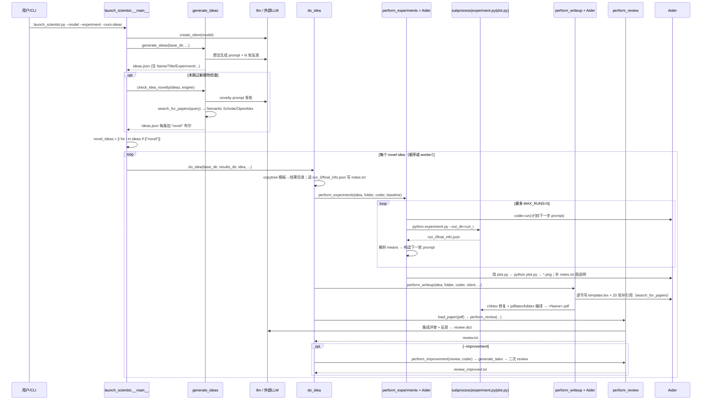

# The AI Scientist v1 — 流水线与数据流

> 基于源码核验：`launch_scientist.py`、`ai_scientist/generate_ideas.py`、`perform_experiments.py`、`perform_writeup.py`、`perform_review.py`。

本文按真实执行顺序拆解每个阶段：**输入 → 处理（谁、调什么）→ 输出（文件/内存对象）**。

---

## 0. 端到端时序图

---

## 1. 阶段一：模板依赖（运行前必须就绪）

`launch_scientist.py` 用 `base_dir = osp.join("templates", args.experiment)`。每个模板目录必须包含：

| 文件 | 作用 | 谁读/写 |
| --- | --- | --- |
| `experiment.py` | 基线实验；接受 `--out_dir`，把结果写进 `<out_dir>/final_info.json` | 被读（`generate_ideas` 作为代码上下文）、被 Aider 改、被 subprocess 执行 |
| `plot.py` | 读各 `run_i` 结果画图，输出 `*.png` | 被 Aider 改、被 `run_plotting()` 执行 |
| `prompt.json` | `{"system": <系统提示>, "task_description": <任务描述>}` | `generate_ideas` / `check_idea_novelty` 读 |
| `seed_ideas.json` | 种子想法数组（字段同 idea dict，通常无 `novel`） | `generate_ideas` / `generate_next_idea` 读 |
| `run_0/final_info.json` | **基线结果**，必须预先人工跑 `python experiment.py --out_dir run_0` 生成 | `do_idea()` 读取作为 baseline |
| `latex/template.tex` | 论文 LaTeX 模板（顶部 `filecontents{references.bib}` + 各 section 占位） | `perform_writeup` 改、`generate_latex` 编译 |

**契约要点**：
- `final_info.json` 必须是 `{key: {"means": {...}}}` 结构；`do_idea` 和 `run_experiment` 都用 `{k: v["means"] for k, v in results.items()}` 解析（见 `launch_scientist.py:do_idea`、`perform_experiments.py:run_experiment`）。
- `plot.py` 中要有 `labels` 字典，Aider 会被提示填充它（`perform_experiments` 的绘图 prompt 明确说 "Only the runs in the labels dictionary will be plotted"）。
- `template.tex` 必须含 `\begin{filecontents}{references.bib}...\end{filecontents}`，否则 `generate_latex` 打印 "No references.bib found" 直接返回。

模板准备（源自根 README）：nanoGPT 需先跑 `data/*/prepare.py`；2d_diffusion 需 `pip install NPEET scikit-learn`；grokking 需 `pip install einops`；三者都要先手工跑一次 `python experiment.py --out_dir run_0 && python plot.py` 生成基线。

---

## 2. 阶段二：想法生成（`generate_ideas.generate_ideas`）

**输入**：`base_dir`、LLM `client`/`model`、`skip_generation`、`max_num_generations`（CLI `--num-ideas`，默认 50）、`num_reflections`（常量 `NUM_REFLECTIONS=3`）。

**流程**：
1. 若 `skip_generation=True` 且 `ideas.json` 存在且合法 → 直接加载返回（跳过生成）。
2. 读 `seed_ideas.json`（每个种子想法 `json.dumps` 后进入 `idea_str_archive`）、`experiment.py`（代码文本）、`prompt.json`（取 `system` 与 `task_description`）。
3. 循环 `max_num_generations` 次：
   - 用 `idea_first_prompt` 填入任务描述/代码/已有想法，调 `get_response_from_llm`（第 1 轮），`extract_json_between_markers` 解析出 JSON。
   - 若 `num_reflections>1`，再用 `idea_reflection_prompt` 迭代 `num_reflections-1` 轮；若回复含 `"I am done"` 提前收敛。
   - 每轮异常都 `try/except` 跳过，不中断整体。
   - 生成的想法再次 `json.dumps` 追加进 archive（**已生成的想法会作为下一轮上下文，避免重复**）。
4. 把 archive 写回 `<base_dir>/ideas.json`，返回 ideas 列表。

**输出**：`<base_dir>/ideas.json`（覆盖写），每个元素字段：`Name`、`Title`、`Experiment`、`Interestingness`、`Feasibility`、`Novelty`。

反思机制：`idea_reflection_prompt` 要求"除非有严重问题否则坚持原想法"，`I am done` 只在不再修改时出现。

`generate_next_idea()` 是开放式的"一次生成一个、带历史 Score"的变体（用于实验性脚本，不在主入口调用路径）。

---

## 3. 阶段三：新颖性检查（`check_idea_novelty`）

**输入**：上一步 ideas、`engine`（CLI `--engine`，`semanticscholar`/`openalex`）。

**流程**：对每个不含 `novel` 字段的想法：
1. 用 `novelty_system_msg`（内含任务描述+代码）与 `novelty_prompt`（第 j 轮）调 LLM；提示词要求扮演"苛刻的 PhD"，最多 `max_num_iterations=10` 轮。
2. 若思考中出现 `Decision made: novel` → `novel=True` 并跳出；出现 `Decision made: not novel` → `novel=False` 跳出。
3. 否则解析 JSON 的 `Query` 字段 → `search_for_papers(query, result_limit=10, engine)`：
   - semanticscholar：`GET https://api.semanticscholar.org/graph/v1/paper/search`，可带 `S2_API_KEY`，字段含 title/authors/venue/year/abstract/citationCount；有 `@backoff.on_exception(backoff.expo, HTTPError)` 退避。
   - openalex：用 `pyalex.Works().search(query).get(per_page=...)`，需 `pip install pyalex`，可选 `OPENALEX_MAIL_ADDRESS`。
   - 返回的前 10 篇论文格式化进 `papers_str`，作为下一轮 LLM 上下文。
4. 给 idea 加 `idea["novel"] = bool`，写回 `ideas.json`。

**输出**：带 `novel` 的 `ideas.json`；主流程只保留 `novel == True` 的想法进入实验。`--skip-novelty-check` 可整体跳过（此时想法无 `novel` 字段，主流程 `idea["novel"]` 会 KeyError——**因此实际使用时若跳过检查，需保证 ideas.json 里已有 novel 字段，或不要跳过**；这是一个已知的边界情况）。

---

## 4. 阶段四：每个想法do_idea——实验

### 4.1 准备工作（模板→结果目录）
1. `folder_name = results/<exp>/<时间戳>_<idea['Name']>`，`assert` 不存在；`shutil.copytree(base_dir, folder_name, dirs_exist_ok=True)`。
2. 读基线 `run_0/final_info.json`，提取 means。
3. 写 `notes.txt`：`# Title`、`# Experiment description`、`## Run 0: Baseline` + 基线结果。
4. 并行模式下把 stdout/stderr 重定向到 `log.txt`。
5. 创建 Aider `Coder`（`fnames=[experiment.py, plot.py, notes.txt]`，`edit_format="diff"`）。

模型映射（`do_idea` 内，实验与写作各一次）：
- `deepseek-coder-v2-0724` → `Model("deepseek/deepseek-coder")`
- `deepseek-reasoner` → `Model("deepseek/deepseek-reasoner")`
- `llama3.1-405b` → `Model("openrouter/meta-llama/llama-3.1-405b-instruct")`
- 其它 → `Model(model)` 原样

### 4.2 `perform_experiments()` 主循环
常量：`MAX_ITERS=4`（连续失败容忍）、`MAX_RUNS=5`（最多 5 次实验 run）、`MAX_STDERR_OUTPUT=1500`。

1. 初始 prompt `coder_prompt`：要求 Aider 先规划实验清单，提示"基线已提供无需重跑"，并强调**必须用 `python experiment.py --out_dir=run_i` 这个命令格式，不得添加额外参数**。
2. `while run < MAX_RUNS+1`：
   - `coder.run(next_prompt)` 让 Aider 改代码；若输出含 `ALL_COMPLETED` 跳出。
   - `run_experiment(folder, run)`：先 `shutil.copy(experiment.py, run_<n>.py)` 存快照，再 `subprocess.run(["python","experiment.py","--out_dir=run_<n>"], cwd=..., stderr=PIPE, timeout=7200)`。
     - 失败（returncode≠0）：删掉 `run_<n>` 目录，返回截断到尾部 1500 字符的 stderr 作为下一轮 prompt。
     - 成功：读 `run_<n>/final_info.json` 提取 means，返回 "Run completed + 结果" 的 prompt，并要求 Aider 把该 run 的实验描述/结果详细写进 `notes.txt`（供后续写作）。
     - 超时（7200s）：删目录，返回 timeout 提示。
   - 成功 → `run += 1`，`current_iter` 归零；否则 `current_iter += 1`；`current_iter >= MAX_ITERS` 提前 break 并最终返回 `False`。
3. 绘图阶段：prompt 要求修改 `plot.py` 的 `labels` 字典，然后循环 `run_plotting()`（`python plot.py`，timeout=600）直到成功或连续 4 次失败。
4. 收尾：让 Aider 在 `notes.txt` 补充每张图说明与文件名。返回 `True`。

**关键约束**：Aider 与框架之间只通过"代码文件 + prompt 文本 + notes.txt"交互；框架不会主动读 Aider 的结构化输出，只检测 `ALL_COMPLETED` 字符串。

---

## 5. 阶段五：写作（perform_writeup）

调用：`perform_writeup(idea, folder_name, coder, client, client_model, engine=args.engine)`，其中 coder 的 `fnames=[experiment.py, latex/template.tex, notes.txt]`（注意**换成 template.tex**）。

流程：
1. **逐节初稿**：先 Title+Abstract，再 `Introduction → Background → Method → Experimental Setup → Results → Conclusion`；每节调 `per_section_tips[section]` 作为写作要点，Aider 写完后调 `refinement_prompt` 做一次自查修正。提示词要求：只用 `references.bib` 已有引用、结果与图只在 Results 节、每节前写注释描述。
2. **Related Work 草图**：只在 LaTeX 注释里规划要讨论哪些论文，明确"不要改 references.bib"。
3. **补引用循环**（`num_cite_rounds=20`）：每轮 `get_citation_aider_prompt(client, model, draft, current_round, total_rounds, engine)`：
   - LLM 先决定"最重要的缺失引用"+ 检索 query（出现 `No more citations needed` → `done=True` 结束）；
   - `search_for_papers(query)` 取 top10；
   - LLM 从结果里选索引（`Selected`），返回 BibTeX；
   - 框架把 BibTeX 插到 `\end{filecontents}` 前，并让 Aider 在正文加 `\cite`/`\citet`（提示词强调 bibtex 里已加，禁止重复添加）。
4. **二次精修**：重新审视 Title，再对 8 个 section 逐个用 `second_refinement_prompt`（含 tips）压缩冗余、查错。
5. **编译**：`generate_latex(coder, folder_name, "<Name>.pdf")`：
   - 正则检查所有 `\cite{}` 是否在 bib 中、所有 `\includegraphics{}` 是否有对应 png、是否有重复图/重复 section，发现问题让 Aider 修。
   - `chktex template.tex -q -n2 -n24 -n13 -n1` 驱动最多 5 轮修错。
   - `compile_latex()` 跑 `pdflatex → bibtex → pdflatex → pdflatex`（cwd=latex/，每条 timeout=30s），最后把 `template.pdf` 移动为 `<Name>.pdf`。

**输出**：`latex/template.tex`（填充后）、`<Name>.pdf`。

---

## 6. 阶段六：评审与改进

### 6.1 评审
1. `paper_text = load_paper(f"{folder}/{idea['Name']}.pdf")`：`pymupdf4llm.to_markdown` → 失败回退 `pymupdf` 逐页 `get_text()` → 再回退 `pypdf`；文本 <100 字符视为失败。
2. `perform_review(...)`（固定 `model="gpt-4o-2024-05-13"`, `num_reflections=5`, `num_fs_examples=1`, `num_reviews_ensemble=5`, `temperature=0.1`）：
   - 用 `neurips_form`（含 few-shot 评审样例 `fewshot_examples/*.txt`）+ 论文文本构造 base_prompt。
   - `get_batch_responses_from_llm` 生成 5 份评审 → 逐份 `extract_json` → `get_meta_review` 让"Area Chair"聚合成一份 → 对 9 个数值字段取四舍五入均值。
   - `num_reflections=5` 再迭代 4 轮反思（含 `I am done` 早停）。
   - 返回 review dict，写 `review.txt`（`json.dumps(indent=4)`）。

### 6.2 改进（仅 `--improvement`）
1. `perform_improvement(review, coder)`：把 review JSON 塞进 `improvement_prompt`，让 Aider（写作阶段的 coder，fnames 含 template.tex）改论文。
2. `generate_latex(...)` 重新编译为 `<Name>_improved.pdf`。
3. 再次 `load_paper` + `perform_review`（同样参数）→ 写 `review_improved.txt`。

---

## 7. 数据流文件总表

| 阶段 | 读 | 写 |
| --- | --- | --- |
| 想法生成 | `seed_ideas.json`, `experiment.py`, `prompt.json` | `ideas.json` |
| 新颖性 | `ideas.json`, `experiment.py`, `prompt.json`, 文献 API | `ideas.json`（加 novel） |
| do_idea 准备 | 模板全目录, `run_0/final_info.json` | 结果目录副本, `notes.txt` |
| 实验 | `notes.txt`, 结果 `experiment.py`/`plot.py` | `run_i/`, `run_i.py`, `*.png`, `notes.txt` |
| 写作 | `notes.txt`, `experiment.py`, `latex/template.tex`, 文献 API | `latex/template.tex`, `<Name>.pdf` |
| 评审 | `<Name>.pdf`, `fewshot_examples/*` | `review.txt` |
| 改进 | `review.txt`(内存), `template.tex` | `<Name>_improved.pdf`, `review_improved.txt` |

---

## 8. 改流程时的注意事项（排错锚点）

- 想改"每个想法跑几轮实验"：改 `perform_experiments.MAX_RUNS` / `MAX_ITERS`，或 `run_experiment` 的 `timeout=7200`。
- 想改"生成多少想法/反思几轮"：CLI `--num-ideas` 与 `launch_scientist.NUM_REFLECTIONS`。
- 想换评审模型：`do_idea` 里评审是**硬编码 gpt-4o**，需直接改源码（不是 `--model`）。
- 想加新模板：严格照第 1 节的文件契约，尤其是 `final_info.json` 的 `means` 结构与 `run_0` 基线。
- 并行 bug：`--parallel>0` 且无 GPU → `get_available_gpus()` 返回空列表导致取模错误；`--skip-novelty-check` + 无 novel 字段的 ideas.json → `KeyError`。两者都是修改时可顺手加固的点。
